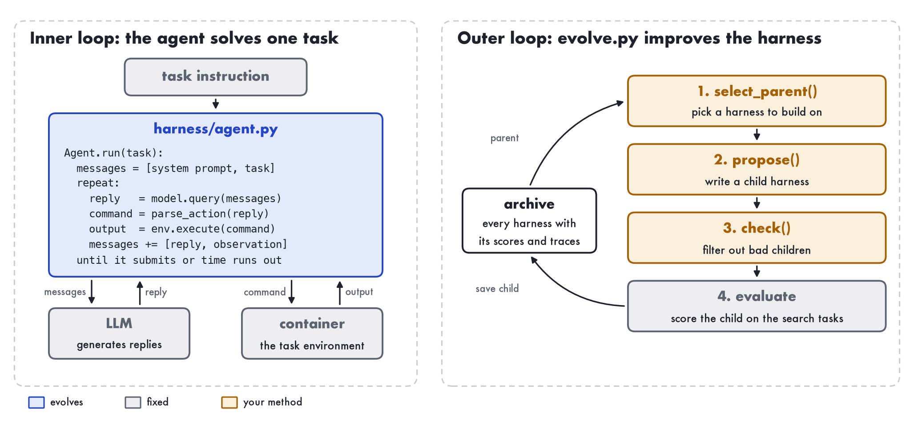

# Homework 2: Evolve a Harness

In this homework you will implement a harness evolver, similar to [Meta-Harness](https://arxiv.org/abs/2603.28052),
which we covered in class. In each round, a coding agent that we call the proposer reads how the current harness
fails and writes a better one. At the end you will look at how the harness changed and whether it generalizes to
held-out tasks.



## Setup

The starting agent is mini-swe-agent v1 with its simplest prompts and `kimi-k2.6` as the model. Its harness, in
`harness/`, is about 100 lines of Python.

The tasks come from Terminal-Bench 2.0. The loop scores every harness on the 11 tasks in `splits/search.txt`, running
each of them three times. The 10 tasks in `splits/test.txt` are held out until the end. As in Terminal-Bench, each
task has a time limit of 15 or 20 minutes and no limit on model calls.

The proposer is Claude Code running Kimi K3 on your Moonshot key.

## Files

You change `evolve.py` and `proposer_prompt.md`. Feel free to add files, such as a prompt for a critic in `check()`.

| file | what it is |
|---|---|
| `evolve.py` | The loop. Your method goes in its functions `select_parent()`, `propose()` and `check()`. |
| `proposer_prompt.md` | The proposer's instructions. |
| `harness/` | The starting harness. `agent.py` is the agent loop and `config.yaml` holds its prompts. The proposer edits copies of it. |
| `splits/` | The search and test task lists. |
| `hw2/` | Fixed code that you do not need to read. It holds the model, the scoring, the traces, the rest of the loop (`loop.py`) and the connection to [Harbor](https://harborframework.com), which runs each task's container and tests. |

## Rules

- Do not use the test split to choose between harnesses, and do not show it to the proposer.
- Do not give the proposer any hand-written harness.
- Report all costs, including the proposer's.

## What the loop saves

Each harness is saved in `runs/<run>/archive/<id>/`, and `archive/summary.md` lists all of them with their scores.

| file | content | can the proposer read it? |
|---|---|---|
| `harness/` | The harness's code. | Yes. |
| `proposal.md` | What its proposer changed and why. | Yes. |
| `meta.json` | Its parent, its proposer's cost, and the reason if it was rejected. | Yes. |
| `scores.json` | The search score, and the reward, exit status, model calls and cost of every attempt. | Yes. |
| `tasks/<task>/trace.md` | Every message the model saw and every command it ran in the first attempt. | Yes. |
| `tasks/<task>/result.json` | The reward, exit status, model calls, cost and error of that attempt. | Yes. |
| `tasks/<task>/tests.txt` | The tests' output for that attempt. | Only if you set `with_tests_output=True`. |
| `jobs/` | Harbor's raw logs of all three attempts. | No. |
| `proposer/` | The log of the proposer's session. | No. |

Each proposer works in its own folder, `runs/<run>/workspaces/<id>/`. It holds a copy of the parent's harness to
edit, the archive files marked "Yes", and the proposer's instructions in `TASK.md`. `propose()` fills this folder,
so you decide what the proposer sees.

## Install

You need Python 3.12 or newer, Docker, Claude Code and a Moonshot API key. On an Apple-silicon Mac, turn on Rosetta in
Docker.

```bash
uv venv --python 3.12 && source .venv/bin/activate
uv pip install -r requirements.txt
cp .env.example .env                 # then put your API key in .env
set -a; source .env; set +a          # do this in every new shell
```

## 1. Baseline

Score the starting harness on the test split. This takes about 20 minutes and $2.

```bash
python -m hw2.evaluate --harness harness --split splits/test.txt --out runs/seed-test -k 3
```

Read a few failed traces in `runs/seed-test/tasks/<task>/trace.md` to see why it fails.

## 2. Design your method

Each round runs the four steps below. Steps 1 to 3 are yours, and `evolve.py` has a simple version of each, marked
TODO. Change at least two of them and explain why in your report.

| step | starting version | ideas |
|---|---|---|
| 1. `select_parent()` | The harness with the best search score (greedy hill climbing). | Sample from the whole archive, favoring high scores and harnesses with few children (DGM). Build only on children that beat their parent by more than the noise (RRSI). Let the proposer choose (Meta-Harness). |
| 2. `propose()` and `proposer_prompt.md` | Claude Code edits a copy of the parent. | Show it the tests' output (Meta-Harness). Ask for several proposals per round. Limit how much one child may change (RRSI). Use another agent or model. |
| 3. `check()` | The child must change something, must not name any task, and its `agent.py` must import. | Run the child on one search task first and reject it if it crashes (DGM). Ask a model to reject changes that only fit these tasks (RRSI). |
| 4. evaluate (fixed) | Scores the child on the search split. | |

## 3. Evolve

Run the loop for at least 8 rounds.

```bash
python evolve.py --run runs/main --rounds 8
```

A proposal takes 4 to 10 minutes and $0.50 to $1.30. An evaluation takes up to about 75 minutes, so 8 rounds take
several hours.

## 4. Test

The search score may be too optimistic, because the loop keeps whichever harness happened to do best on those 11
tasks. Score your best harness on the test split.

```bash
python -m hw2.evaluate --harness runs/main/archive/<best>/harness --split splits/test.txt --out runs/main/test -k 3
```

Compare it with your baseline task by task, using `scores.json` and the traces. To see what the loop changed, run
`diff -r harness runs/main/archive/<best>/harness`. Then answer these questions in your report.

1. Do you think the improvement generalizes? Compare the gain on the test split with the gain on the search split.
2. How often does a harness get different results on the same task across its three attempts? Is your gain bigger
   than this noise?
3. What changed from the starting harness to your best one?
4. Why does it work? Explain it with the traces of tasks that flipped.

## 5. Submit

Hand in `report.md` (from `report_template.md`), `evolve.py`, `proposer_prompt.md`, any files you added, and a zip of
your archive.

```bash
zip -r archive.zip runs/main/archive
```

## References

- [Meta-Harness](https://arxiv.org/abs/2603.28052). The proposer is a coding agent that reads the code, scores and raw
  traces of every earlier harness. The starting loop works this way.
- [Darwin Gödel Machine](https://arxiv.org/abs/2505.22954). It keeps every agent in an archive and samples parents
  from all of it. It tests a new agent on a few tasks before running the full set.
- [RRSI](https://arxiv.org/abs/2609.24972). Harness evolution tends to overfit the tasks it is scored on. RRSI keeps
  each change small, uses a critic to reject changes that only fit the benchmark, and ignores gains within the noise.
- [ADAS](https://arxiv.org/abs/2408.08435). A meta agent writes new agents as code and builds on an archive of earlier
  designs.
- [mini-swe-agent](https://github.com/SWE-agent/mini-swe-agent) is the starting agent and
  [Terminal-Bench](https://www.tbench.ai) is the benchmark.
